# Polku

**An outdoor map for Finland: trails, terrain, water and weather in one place.** Plan a ride, a run, a hike or a paddle, see how hard it is in both directions and what the weather does on the way, then take it with you, offline if you need.

**→ [polku.si](https://polku.si)** · free · no account · works on your phone · [what's new](CHANGELOG.md)

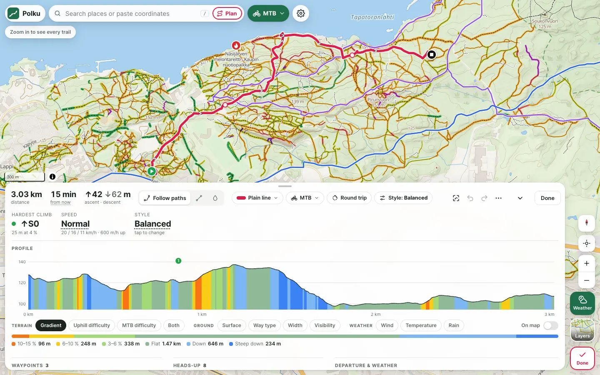

Polku is a web app built on open data. It runs in your browser, keeps your settings and routes on your device, and talks only to free public services.

---

## Trails the way you ride them

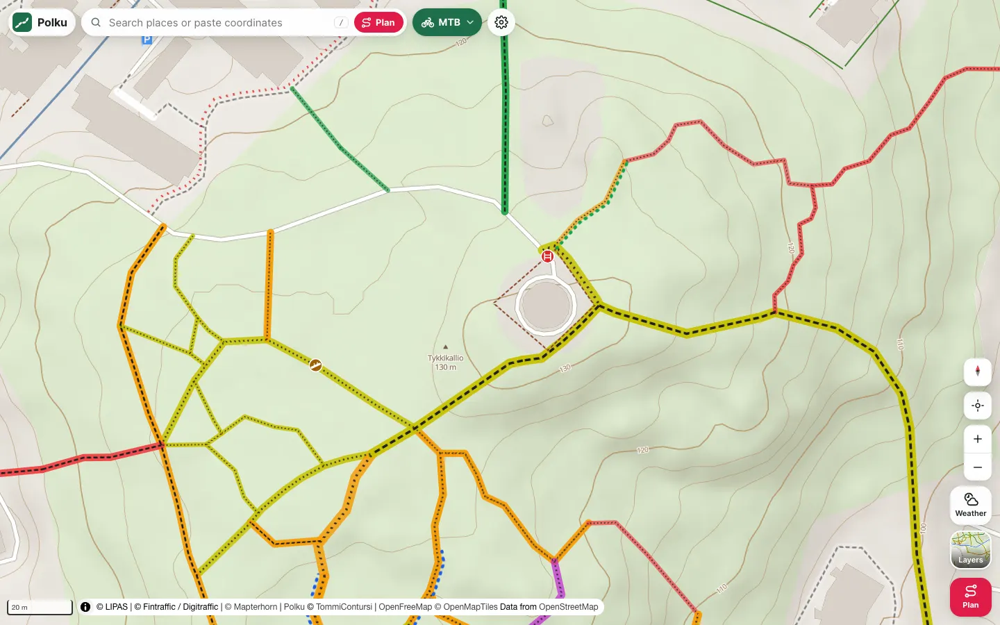

- **MTB difficulty** (S0–S6) as a coloured halo on every trail, and **uphill difficulty** (↑S0–↑S5) computed from the lidar elevation model, with arrows up the climb. Show either, or both.
- **Trail details** from OpenStreetMap: how wide a trail is, how easy it is to follow, overgrown and wet stretches, fallen trees, gates, fences and fords, drawn the way a rider reads them.
- **Hillshade, 5 m contours and 3D terrain**, and base maps from the trail map to the National Land Survey's terrain map and aerial photos.
- Rest the pointer on anything for a quick preview; click for the details, all OSM tags, and a link to fix the map.

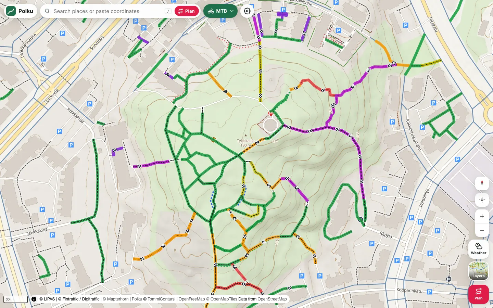

## Plan a route in any sport

MTB, gravel, road cycling, hiking, trail running, running, paddling and swimming. Each has its own router, speeds, warnings and map, and **one route can mix them**: bike to the shore, paddle across, run on the island, with the changeovers in the time.

- **Click to route, drag to change:** drag a point or the line itself and the route follows as you drag. Undo covers everything.
- **Click or tap a part of the route** to add a point there or change that part: its sport, how it's routed, its style. With the planner closed, a click on your route opens it.
- **Route style in the sport's own words:** Flowy trails, Technical, Smooth & easy, Paved roads, Nature paths, Near the shore… For the whole route or a single leg.
- **An elevation profile** coloured by gradient, uphill or MTB difficulty, trail width or visibility, surface, wind, temperature or rain, on the map too if you like.
- **Heads-up** lists what's on the way: steps, no-bike sections, fallen trees, hard-to-follow trails, road works, busy roads, carries. Each comes with an *Avoid* button.
- **Your speeds** (Easy / Normal / Fast, or your own), and a time that accounts for the wind, with **distance marks** on the route, the times you'd pass them, and **sunrise and sunset** (Heads-up says when you'd be out in the dark).
- **Stops and nights:** a break or a night at any point ("go on at 08:30"). The times and the weather follow, a trip shows its days, and a night finds lean-tos, huts and campsites nearby. Heads-up tells you if your bike or boat is left somewhere the route doesn't come back to.
- **GPX import and export,** and a share link that carries the whole route.

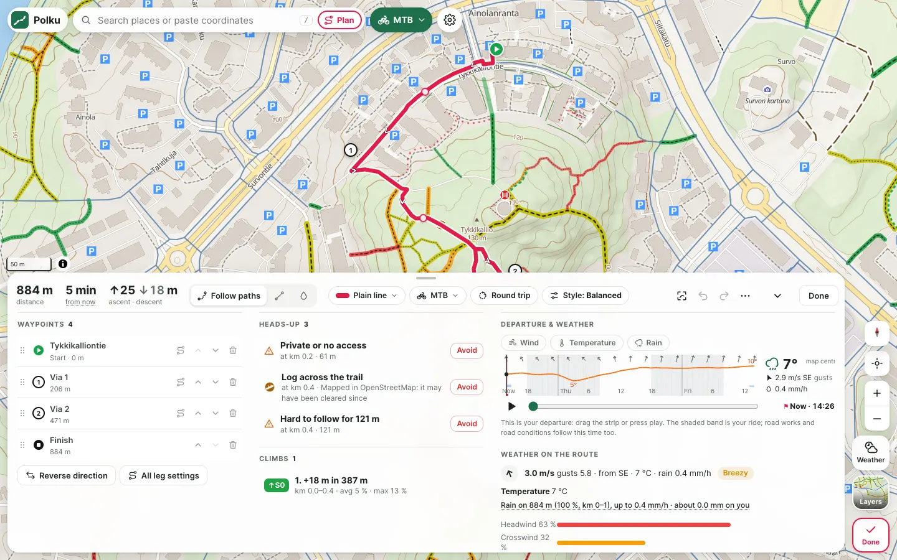

  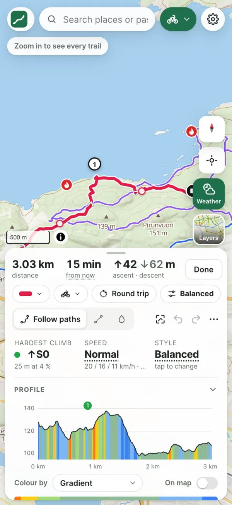
  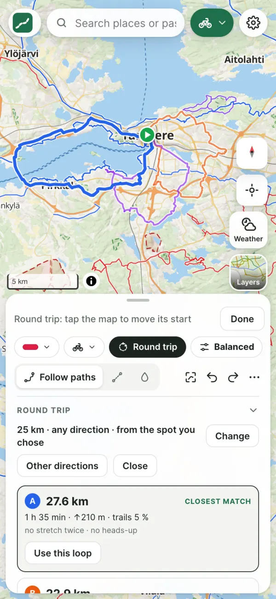
  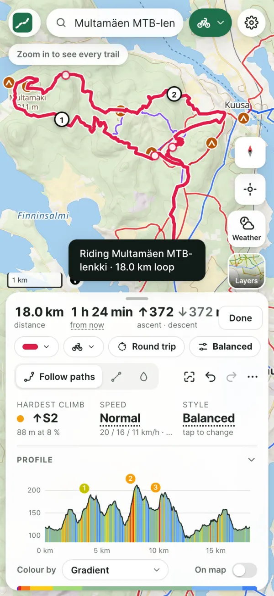

## Round trips

Pick a start, a length in kilometres or time, and a direction ("into the wind first" works too). Polku makes three loops in your route style and compares them: distance, time, climbing, the share of trail, how much is ridden twice, and what Heads-up found. None of them right? **More loops** makes three more in other directions. Pick one and it becomes a normal route you can edit.

**On the water too:** paddling and swimming loops come from Polku's own water router, with no routing calls. They keep to your style (near the shore, across shipping lanes, out of rough water), and on a river they go out and back.

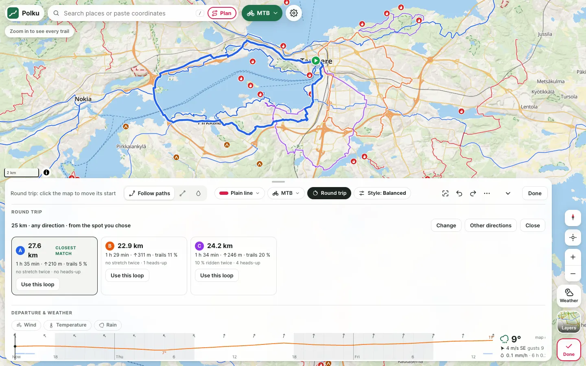

## Official routes and places

Finland's national register of sports places, [LIPAS](https://lipas.fi), puts official hiking, MTB, cycling and paddling routes on the map, along with lean-tos, huts, campfire sites and landing places.

- **Search them by name:** "koko kierros", "laajavuori", "laavu". The results are grouped into places, routes, stops and trails.
- **Ride this route** turns a LIPAS route into your plan using its own line, with no routing calls. **Add to route** joins it onto yours.

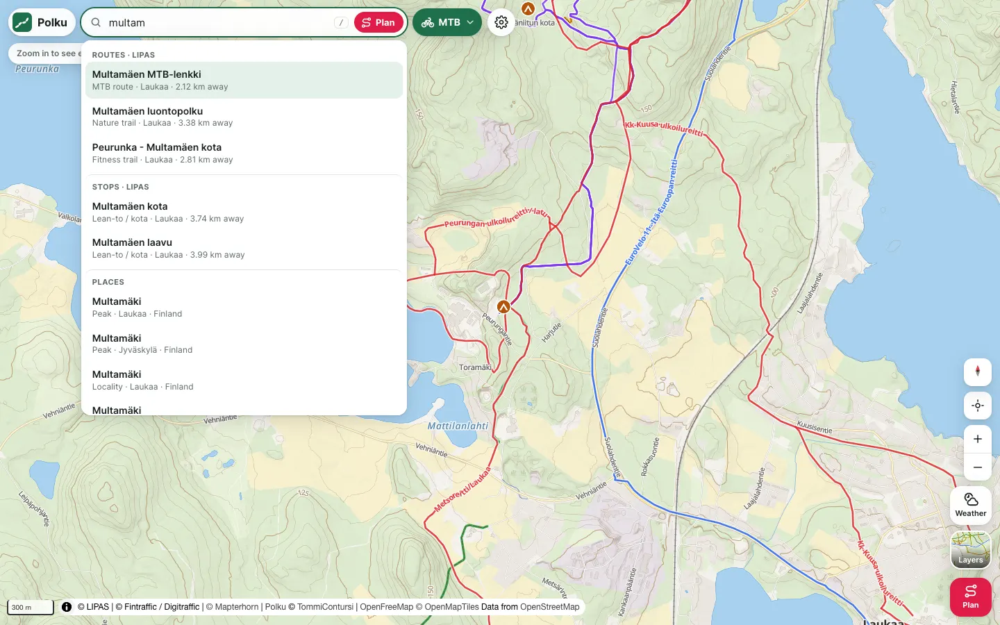

## On the water

An open-water router for sea kayaks, canoes and SUPs. Routes stay on the water and flag the carries.

- **Shipping lanes are crossed straight and quickly,** not followed (Väylävirasto's fairways).
- **Marked rocks and shoals are kept clear of:** danger and cardinal marks, and OpenStreetMap's rocks and reefs.
- **Out of the wind:** waves build where the wind has a long way over open water, so a SUP keeps to calmer water than a kayak.
- **A nautical chart** for the sea and lakes (buoys, lights and sectors, fairways, speed limits), Traficom's charted depths (not for navigation), and live ships.

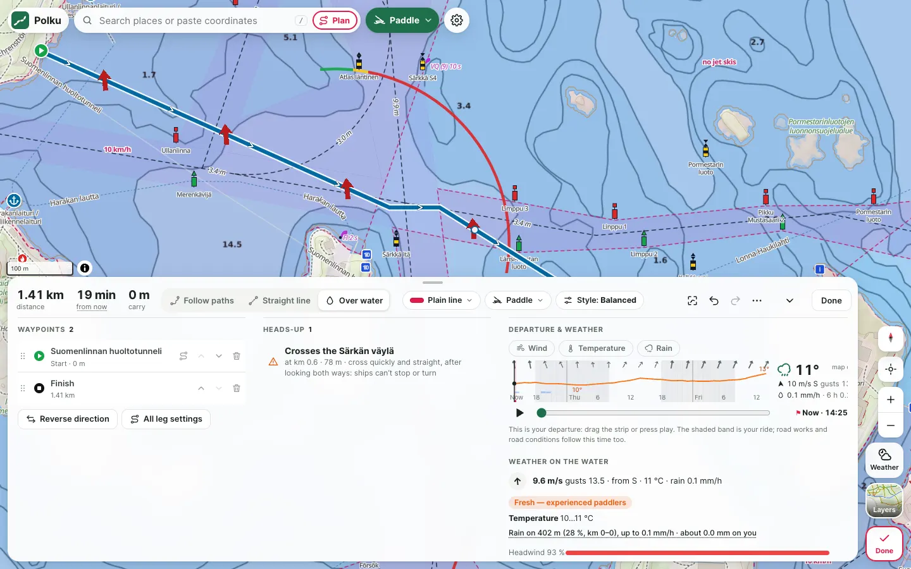

## Weather that follows your plan

- **A 48-hour timeline** drives everything that depends on time: the weather layers, your departure, road works and road conditions.
- **Wind, rain and temperature on the map,** animated, with the rain radar for "now" (FMI in Finland).
- **Along your route,** head-, cross- or tailwind, temperature and rain at the time you reach each part.

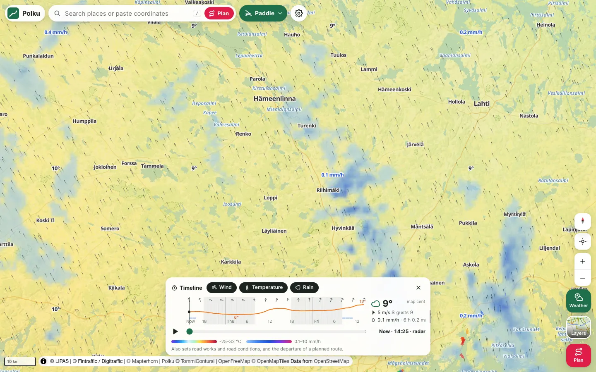

## Traffic and safety

- **Busy roads** as a heat line (vehicles a day), live incidents, road works at your departure time, and slippery roads for the next 12 hours.
- **Military areas and shooting ranges.**
- **800+ road weather cameras,** each with a 24-hour time-lapse.
- **A planned route is checked against all of these.**

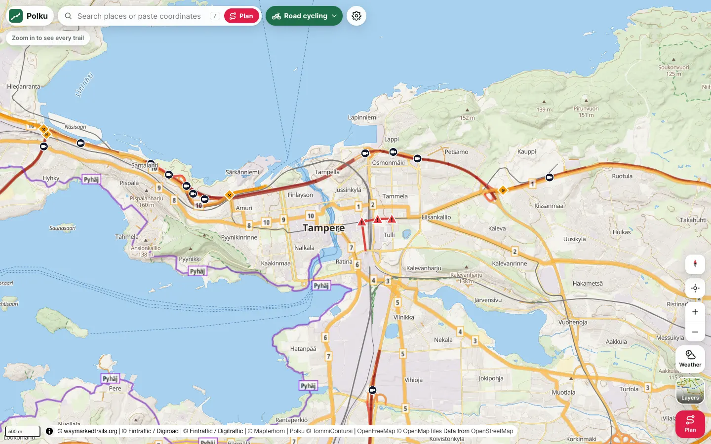

## Offline

**Save offline** stores the map and terrain along a route, together with the route itself, so the map, the route and its profile work with no signal, and the app loads without a connection. **Preview offline** shows only what's saved, so you can check before you go. On an iPhone, add Polku to the home screen so the browser keeps it.

---

## Private by design

There are no accounts, cookies, analytics or servers of Polku's own. Your settings, your last route, cached map data and offline areas stay in your browser. The map talks directly to the open data services below, which see your IP address and the area you're looking at.

## Keys and gestures

| | |
|---|---|
| <kbd>T</kbd> | timeline |
| <kbd>L</kbd> | layers and the map key |
| <kbd>R</kbd> | route planner |
| <kbd>F</kbd> | show the whole route |
| <kbd>/</kbd> | search |
| <kbd>Ctrl</kbd>/<kbd>⌘</kbd>+<kbd>Z</kbd>, +<kbd>Shift</kbd> | undo, redo |
| <kbd>Esc</kbd> | close panels |

Pinching, or Ctrl+scrolling, over any panel zooms the map, not the page. In 3D, a two-finger trackpad scroll tilts and rotates, Shift+scroll tilts anywhere, and the orbit pad, right-drag and two-finger touch work too.

## Data and credits

[OpenStreetMap](https://www.openstreetmap.org/copyright) contributors · [OpenFreeMap](https://openfreemap.org) vector tiles (© OpenMapTiles) · [Mapterhorn](https://mapterhorn.com) terrain · [BRouter](https://brouter.de) routing · [Valhalla](https://valhalla.github.io/valhalla/) on [FOSSGIS](https://www.fossgis.de) servers when BRouter pauses · [Photon](https://photon.komoot.io) search · [Overpass API](https://overpass-api.de) · [LIPAS](https://lipas.fi) (University of Jyväskylä, CC BY 4.0) · Väylävirasto (fairways and aids to navigation, CC BY 4.0) · Traficom (depths, shown only and not for navigation: its licence excludes route planning) · Fintraffic [Digitraffic](https://www.digitraffic.fi/en/) and Digiroad (CC BY 4.0) · Maanmittauslaitos via [Kapsi ry](https://kartat.kapsi.fi) (CC BY 4.0) · Esri World Imagery · [Waymarked Trails](https://waymarkedtrails.org) · [Open-Meteo](https://open-meteo.com) · [FMI open data](https://en.ilmatieteenlaitos.fi/open-data) rain radar · [RainViewer](https://www.rainviewer.com/api.html) · [MapLibre GL JS](https://maplibre.org) and [maplibre-contour](https://github.com/onthegomap/maplibre-contour)

These are free public services, so Polku is gentle with them: requests are paced, cached and counted (Settings → Data sources). Offline areas save only OpenFreeMap and Mapterhorn tiles, whose terms allow it.

## Limits worth knowing

- The full trail network shows from **zoom 14**.
- **Uphill grades, times and wave heights are estimates** from terrain, tags and forecasts, not ground truth.
- **The nautical layer and the paddling routes are for planning, not navigation.** Polku doesn't know depths, so carry an official chart and keep a lookout. Water routes don't know currents, rapids, private shores or bird-protection areas.
- **Paths on the map aren't necessarily official routes.** Everyman's rights apply; check local rules.
- **Routing, search, weather and traffic need a connection.** Offline areas cover the map, terrain and your route.
- No open source of FMI weather or forest-fire warnings allows access from a browser, so those aren't shown.

## Developing

It's a static site with no build step: `python3 serve.py` and open <http://localhost:8765>. How it's built, the tools and tests, and how to work on it are in [docs/DEVELOPING.md](docs/DEVELOPING.md). What's new is in the [changelog](CHANGELOG.md); what's coming is in [docs/ROADMAP.md](docs/ROADMAP.md).

## Background

Polku started as an experiment loosely inspired by [Trailmap](https://web.trailmap.fi): a trail map of Finland with MTB difficulty. It has since grown its own way, with uphill grades, paddling, weather, safety and offline maps. It's an independent project, not affiliated with Trailmap, and uses none of its data or services.

Made by [@TommiContursi](https://github.com/TommiContursi).
