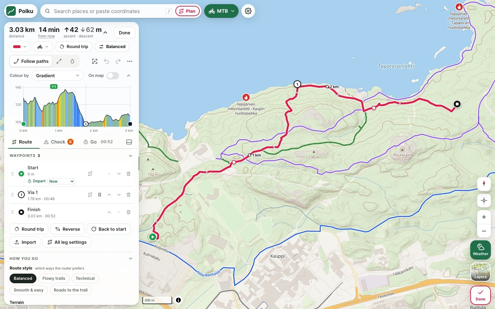
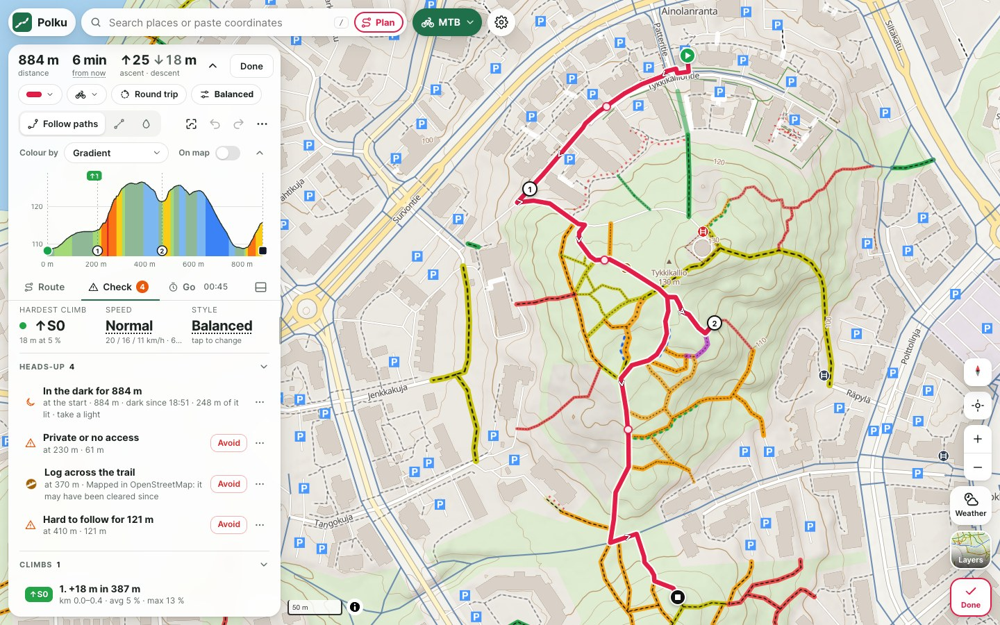
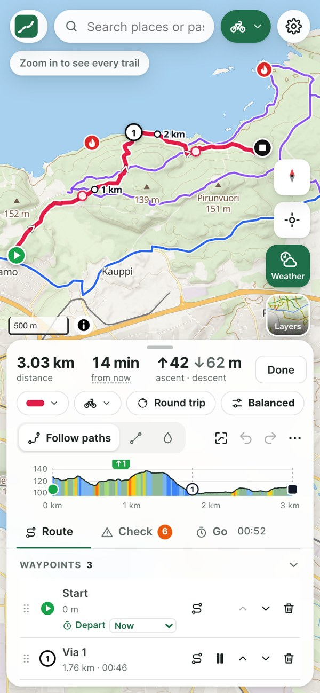
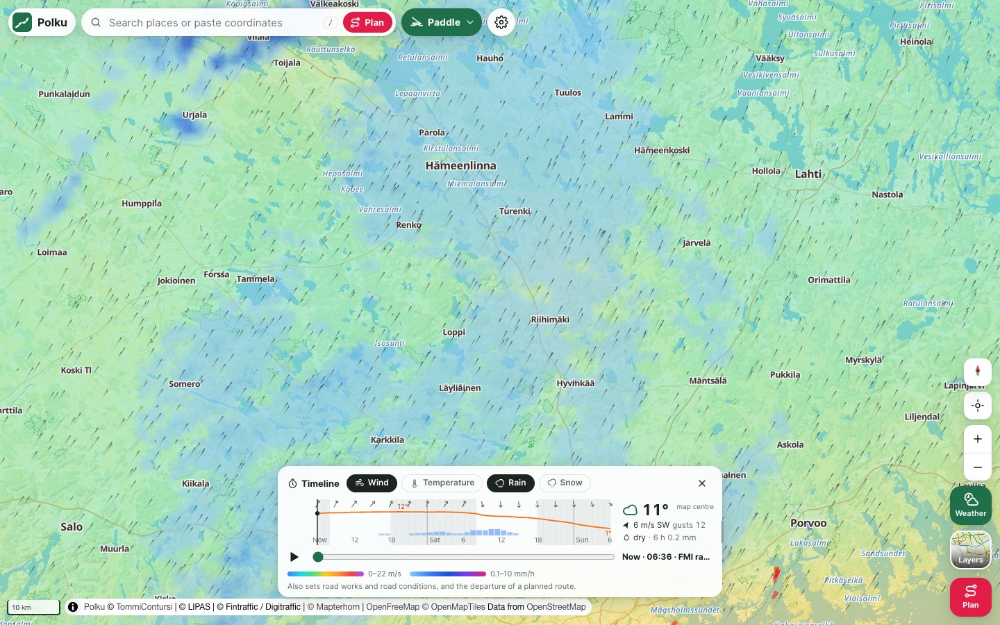
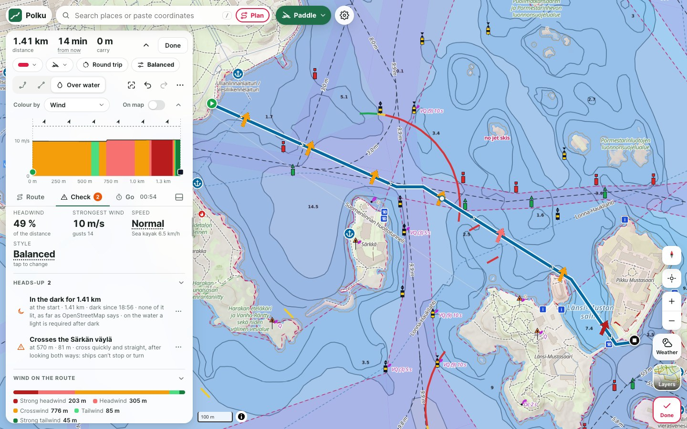

# Polku

Polku is a free outdoor map and multi-sport route planner for Finland. It supports mountain biking, gravel and road cycling, hiking, trail running, running, paddling and swimming, including trips that combine sports.

[**Open Polku →**](https://polku.si/)

Works in your browser, on your phone or computer. No installation or account needed.

## Maps and trails

The map has hillshade, 5 m contours and 3D terrain, which its **3D** button turns on and off; with **Raised hills** off, 3D only tilts the flat map. In 3D the buildings stand up at their heights from OpenStreetMap, about 5 m where it has none, unless **3D buildings** is off. The hillshade can be lit by the sun at the weather line's hour instead of a fixed light, with the shadows that hills, and trees and buildings, cast (each a switch of its own), worked out on the device from the elevation data, Meta and WRI's canopy heights (from pictures taken up to 2020) and OpenStreetMap's buildings. Base maps include the trail map, the National Land Survey's terrain map and aerial photos. **Layers** opens a quick drawer with the base maps and five layers for your sport as tiles, which you can swap for any others; **More** has every layer and the map keys.

Aerial detail depends on the imagery available at that place. When closer imagery is missing, **Aerial** keeps the available coarser image; further zoom enlarges that image.

- Trail colours show mountain biking difficulty (S0–S6) and estimated uphill difficulty (↑S0–↑S5), separately or together, with arrows pointing uphill. Polku samples the elevation model along trails, smooths the heights and grades short sections by climbing gradient, with adjustments for loose surfaces and mapped technical difficulty. Explicit OpenStreetMap uphill grades take precedence.
- Trail width and visibility, wet or overgrown stretches, fallen trees, gates, fences and fords come from OpenStreetMap. Select a feature for details and a link to help correct the map.
- Lit ways shows the paths and streets OpenStreetMap says are lit after dark, and those it says aren't, as lines or in the dark: the map dimmed and the lit ways glowing. A way it says nothing about has no line, and a part of the map whose lighting didn't load isn't dimmed. A message on the map shows loading progress and offers a retry when data is missing.
- Search finds official hiking, MTB, cycling and paddling routes from Finland's [LIPAS](https://lipas.fi) register, alongside lean-tos, huts, campfire sites and landing places. The planner's start lists the official routes in the map's view for your sport. Follow one as your plan on its recorded line.

## Route planning

Routing, speeds, route styles and warnings depend on the sport. A route can change sports between legs: cycle to the shore, paddle across and run on an island. The time estimate includes changeovers.

On land, BRouter calculates routes using sport-specific profiles. Polku keeps unchanged legs when you edit a route, shares identical requests and cancels work that edits make obsolete. It reuses saved geometry after a reload. If BRouter pauses or stops responding, a Valhalla fallback can take over, with a notice in Check. Optional details that do not arrive remain unknown.

- With editing off, clickable roads, paths, routes and places show a pointing-hand cursor. Hover hints appear from the map's own data before fuller details arrive.
- A route begins with drawing it, a round trip, an official route in view, or a GPX or KML file. Add waypoints on the map and drag a waypoint or the route line to change it. A tap on a waypoint, holding it or a right-click opens its card: when you'd get there, how far along and how high, the route's profile up to it, whether you pass by, stop or stay the night, the sport from there on, **Move** by a tap, **Rename**, **Start here**, **End here** and **Remove**. Draw the next leg along paths, freehand or over water, in any sport, change the sport or style for any leg, and undo changes. A waypoint put on open water asks whether to paddle or swim there. The planner's header shows the route; its tools are in a toolbox beside the map's buttons on a phone and a toolbar on a desktop, with the whole route's actions in **More**. **Done** ends editing and keeps the route open to read, check and take along, where a tap on the map shows what's there and the cards still change the route; the planner opens again as you left it, after a reload too. The route glows, and chevrons drift along it the way it goes (Settings can turn them off). A tap on the route opens its card: the way there and three numbers for your sport, **Add a waypoint here**, the stretch to the next waypoint you see with **Edit this stretch**, and what the map knows of the way. A tap on a street, a trail or a cycleway picks the whole of it, drawn on the map like a route, and its card says the same whatever your sport: its length, up and down, a height profile coloured like the map that you can point at, which folds away, with **Colour by** under it for every fact that changes along the way (the route's list with width and visibility, and bikes, one way, lit, speed limit, smoothness and winter care), the facts in groups (how you cycle along it in plain words with a sign, a grade as a badge in its colour), the weather and what OpenStreetMap doesn't have. A tap on a lake or a park draws its outline, and its card has what it is and, on the water, the charted depth (displayed only) and **Paddle from here**. Every card has its actions under its numbers, and the rest further down under **More for this …**; **⋯** beside its ✕ sets what its profile and the route on the map are coloured by. The card of a spot, a way or a place has **Add to my route**, which puts the spot where it fits in the route (a place's waypoint takes the place's name), **Avoid this spot**, **Share** and **Weather here** in a row, and **Start here**, **End here** and **Round trip from here** under them, and holding the map still for half a second, or a right-click, opens the same card; a tap on a place's icon shows its card even while you draw, and a spot can be shared as a link that carries only the spot, or have the weather line's reading held on it. The same by keyboard: Tab to the map for a crosshair, Enter and Shift+F10, and on to the waypoints, Enter opening one's card. Route's list is in sections, a new one where the sport changes, at a stop and at a night, with **Reorder**; a stretch unfolds into its legs, each with its numbers, its warnings by name and a card of its own, and **List settings** choose the times (from the start or by the clock) and what the rows show, and a tap on each part's heading (its ⚙) changes its sport, speed and route style; Route opens with that list, then **Route style** and **Your speed**.
- When you add a waypoint and stop for a moment, other ways to it can appear on the map, drawn like the route in blue, each labelled with its extra length and share of trails beside the route's own share; select one to take it, and the way you had stays, grey, to go back to. Any part of the route offers **Other ways** too. They cost extra routing calls, so on the public BRouter they come only when the service's pacing has room, and not on legs under 300 m.
- Route styles change the router's preferences for terrain, surface, climbing and roads, with presets for flowing trails, technical riding, paved roads, nature paths or routes near the shore. Set a style for the whole route or one leg.
- Routes keep off ways marked private in OpenStreetMap, and Check says when a route goes round one. Where you may go there, the route style's **Short cuts ok** lets a route through such a way when it saves a real distance; ways marked no access stay closed.
- For a round trip, choose a start (your first waypoint, a tap on the map, or where you are), a distance or duration, and a direction, including into the wind first. Polku generates three loops to compare by distance, time, climbing, trail share, repeated stretches and warnings. Its ranking penalises distance from the target, repeated sections, warnings and carries. Generate more loops or edit one. Paddling and swimming loops work too; on rivers they go out and back.
- The elevation profile shows climbs and descents, coloured by gradient, trail difficulty, surface, trail width or visibility, or weather. Check groups available colour breakdowns by terrain, ground, weather and sport, independently of the selected profile colour. Category distances line up beneath each bar; select its title or bar to colour both the profile and the route on the map. Hover a bar segment or legend row to highlight matching stretches on the map. Group headers fold their breakdowns together. Time estimates use preset or personal speeds and allow for wind and snow.
- Stops and overnight stays update the schedule and route weather. Set a break, or a stay of one night or several and the time to go on. For overnight stops, Polku finds nearby lean-tos, huts and campsites. It also warns if a trip leaves your bike or boat somewhere you do not return to.

  

## Weather and conditions

Route weather shows headwind, crosswind, tailwind, temperature and rain at the estimated time you reach each part of the route. The weather line plays the map's weather over the next 48 hours, with FMI rain radar for current rainfall in Finland and its last 90 minutes, and the map hatched where no radar reaches. The map has one weather colour at a time (rain and snowfall, clouds, wind speed, temperature or snow on the ground) and, on top of it, any of thunder (FMI's lightning of the last hour, by age, and the forecast's thunder), animated wind lines and the weather at places: the sky, the temperature and the wind at the places the map names, from the same forecast; a tap reads a place's hours. The line's hour is apart from the route's departure, and closing the line goes back to Now. Rain, snowfall and snow depth are drawn in colour steps, as weather services draw them, and a legend over the map says what each colour means. **Effects**, on at first, softens the steps' edges and lets thin rain and snow fall; with reduced motion they stay still. Distance marks show estimated arrival and elapsed times in minutes by default, with their switches under **Your route** in all layers. **When**, on the first screen, on the start's card and in the trip's box under the route's profile, opens one menu: **Leave now**, or **Leave at…**, which opens the phone's own date and time picker for any day ahead (a desktop shows the field with **Set**). The trip's box says when you'd be there and each day's temperature, rain and the dark, and opens the weather card: for each day one sentence with the sky, up to three notes on what changes a decision (thunder, rough water, gusts and headwind over the sport's limit, rain's start, the dark, low sun and more, ranked by danger first), the temperature with how it feels, the wind and its gusts, the rain on you and a paddle's highest waves (an estimate), the day's hours in a strip you scroll sideways, as weather apps show them, with the temperature, the sky, your trip across your hours and a section each for the rain, the wind against you or behind you and the dark; when the weather changes on the way a line of the trip with a lane for the wind, rain, thunder or waves; then the hours where you'll be in a table, the wind on the way stretch by stretch, and where the time goes, which selecting the summary estimate opens. Check warns of thunder in the forecast where you'd be. The route coloured by wind marks a headwind strong from the sport's limit (6 m/s on a ride, 8 on foot, 5 on the water), and the cold warnings count the wind by its direction. The forecast reaches ten days ahead: past it the route says no forecast yet, and its wind, rain and waves aren't checked there. The planner includes sunrise and sunset.

Polku first estimates the route's timing, then samples forecasts for the expected arrival times along it. It recalculates travel times with the wind and samples the forecasts again for the revised schedule. Stops, overnight stays and changeovers are included in that schedule.

The route's **Check** brings together mapped obstacles and access restrictions, busy roads, incidents, road works, slippery roads, military areas and shooting ranges, in three groups: **Warnings**, **Good to know**, and **Not checked** for a source that didn't answer or wasn't asked on a route that long. Each warning says where it comes from, and is marked on the route. A line under the route's numbers says what stands out on it (a water leg's wind, rain, a headwind that adds time, unpaved on a road bike), or the sport's usual fact, such as the hardest climb, and Check's top keeps them all. While a warning is still unread, or a source didn't answer, that line says how many instead, in the same place, and a tap opens Check at the first. Where a warning offers **Avoid it**, use it to plan around that spot. You can mark warnings read, and the line shows the route's fact again; they stay in Check and on the map. Polku checks only what its sources know: nothing listed doesn't mean a way is open, safe or allowed. Road weather cameras include a 24-hour time-lapse.

Winter mode can follow local snow conditions automatically or be set manually. Its layers show snow depth and FMI measurements, trails classified by how soon they open after snow, ploughed paths, winter access restrictions, ski tracks, skating and snowmobile routes, and FMI sea-ice charts. Route time estimates allow for snow; warnings cover freezing rain, cold, darkness and the ice season on water.

## Water routes

Water routes support paddling and swimming on lakes, rivers and through the archipelago, including legs in a multi-sport trip.

- Paddling routes support sea kayaks, canoes and SUPs and flag sections where carrying is needed.
- Wave estimates use the length of open water upwind, with routing preferences for each craft. An exposed crossing can cost more than a sheltered detour, especially for a SUP.
- Routes aim to cross shipping lanes directly rather than follow them, and keep clear of mapped danger marks, rocks and shoals.
- Nautical layers show buoys, lights, sectors, fairways, speed limits and charted depths.
- Live ship positions come from Fintraffic's AIS feed. Select a vessel for its name, type, speed, course, destination and position age, where reported, or use **Follow on map**. Tracks record positions received while the map is open; a dashed ten-minute projection assumes the ship keeps its reported course and speed.

Water routes are calculated in the browser. Polku turns the map's water polygons into a grid and uses A* to find a path weighted by shipping lanes, mapped hazards, wind exposure and places you have chosen to avoid. It then simplifies the result into straighter legs while checking the same routing costs.

**Water routes and nautical layers are for planning, not navigation.** Depths are displayed only and never used for routing. Carry an official chart; see the [limitations](#limitations) below.

## Offline and sharing

**Save offline** stores the map and terrain along a route, together with the route and its profile, so Polku can load without a connection. **Preview offline** shows only what is saved, so you can check coverage before leaving. Routing, search, weather and traffic still need a connection. On an iPhone, add Polku to the home screen to help keep offline data available.

Routes can be imported from GPX or KML, exported as GPX, or shared with a link. A share link carries when you leave, once it's set; a date that has passed opens leaving now. An exported GPX has the planned times in its waypoints' descriptions and none on the track, so other apps don't read it as a recorded activity. For an imported track, use GPX to preserve its exact line: share links may route it again.

Polku runs in your browser, with no account, cookies, analytics or backend of its own. Settings, routes (including your last route), cached data and offline areas stay in browser storage. Requests go directly to the data services below, which receive your IP address and the map area or route coordinates needed to answer them. Your position is used on your device and sent only when you ask for something from where you are: a round trip from **Where I am** starts there, rounded to about a metre, so that start is routed like any other waypoint, and kept with the route if you take one of the loops. Nearby search and ship information use an approximate map centre instead.

## Data & credits

Polku brings together open data and free public services. Each source keeps its own terms and attribution requirements.

| Used for | Sources |
|---|---|
| Map and trail data | [OpenStreetMap contributors](https://www.openstreetmap.org/copyright); [OpenFreeMap](https://openfreemap.org) vector tiles (© OpenMapTiles) |
| Terrain and base maps | [Mapterhorn](https://mapterhorn.com); Maanmittauslaitos via [Kapsi ry](https://kartat.kapsi.fi) (CC BY 4.0); Esri World Imagery |
| Routes and outdoor places | [LIPAS](https://lipas.fi), University of Jyväskylä (CC BY 4.0); [Waymarked Trails](https://waymarkedtrails.org) |
| Routing on land | [BRouter](https://brouter.de); [Valhalla](https://valhalla.github.io/valhalla/) on [FOSSGIS](https://www.fossgis.de) servers as a fallback |
| Search and detailed map features | [Photon](https://photon.komoot.io); hosted OSM extracts from [Geofabrik](https://download.geofabrik.de/) on ducksoft.fi; [Overpass API](https://overpass-api.de) fallback |
| Fairways and navigation marks | Väylävirasto (CC BY 4.0) |
| Displayed water depths | Traficom: not for navigation; its licence excludes route planning |
| Traffic and road conditions | Fintraffic [Digitraffic](https://www.digitraffic.fi/en/) and Digiroad (CC BY 4.0) |
| Weather and radar | [Open-Meteo](https://open-meteo.com); [FMI open data](https://en.ilmatieteenlaitos.fi/open-data); [RainViewer](https://www.rainviewer.com/api.html) |
| Map rendering | [MapLibre GL JS](https://maplibre.org); [maplibre-contour](https://github.com/onthegomap/maplibre-contour) |

Requests are paced, cached and counted; see **Settings → Data sources**. Offline areas save only OpenFreeMap and Mapterhorn tiles, whose terms allow it.

Road/path selections and their route memberships, trail details and barriers,
mapped winter maintenance/access, OSM water hazards, overnight places and
lighting use hosted OpenStreetMap snapshots for Finland, Sweden, Norway and
Estonia, from Geofabrik and served by ducksoft.fi. Full-tag inspection uses the
same original objects; selected-way tags reuse the already loaded ways. Releases
with local area geometry also supply lake, park and protected-area selection.
Large areas download only nearby original outlines; area details reuse their tags.
Only local tiles are downloaded. Valid hosted cache comes first, followed by
covered hosted tiles and bounded cached/public Overpass fallback. Actual extract
polygons determine coverage, including their proven union at shared borders;
genuine coverage gaps, unsupported objects,
ambiguous nearby relations and lake/park area selection retain public fallback.
Missing data remains unknown. Routing and map tiles keep their existing sources.
Weekly full rebuilds publish automatically after integrity, coverage and browser
checks, with daily live checks and assigned GitHub failure alerts. Inbox and email
delivery have been verified. The
[operations guide](docs/OSM_DATA.md) covers activation, publication, source freshness,
rollback, data licensing and the host's logging requirements.

Polku's original application code is proprietary: © 2026 Tommi Contursi, all rights reserved. Using the free service does not grant permission to reuse its code in another product. See [LICENSE](LICENSE) and [THIRD_PARTY_NOTICES.md](THIRD_PARTY_NOTICES.md); third-party code and data retain their own licences.

## Limitations

- **Estimates and mapped data have gaps.** Uphill grades, travel times and wave heights are estimates from terrain, tags and forecasts. They cannot confirm conditions on the ground.
- **Water routing cannot assess every hazard.** It does not use depths and does not know currents, rapids, private shores or bird-protection areas. Use official charts and keep a lookout.
- **A path on the map is not necessarily an official route or permission to enter.** Respect everyman's rights, access restrictions and local rules. Ski tracks are not for walking or cycling.
- **Offline covers the saved map, terrain and route.** Routing, search, weather and traffic still need a connection.
- **The full trail network appears from zoom 14.** Zoom in if trails seem to be missing.
- **FMI weather and forest-fire warnings are not shown.** No open source currently allows Polku to fetch them directly from a browser.

## Using Polku

See the [user guide](docs/USING.md) for controls and keyboard shortcuts.

## Changelog

Open **Settings → About Polku → What’s new** for recent changes inside the app, or read the [changelog](CHANGELOG.md). Release notes load on demand; their latest date is shown, and a saved copy may appear with a slow or missing connection.

## Background

Polku grew out of planning outdoor trips with Trailmap, Strava, Komoot, Windy.app, Orca and the National Land Survey's maps. It combines detailed trail maps, multi-sport routes, weather at estimated arrival times and water-route planning in one browser app.

Polku is an independent project. Use it at [polku.si](https://polku.si).

Made by [@TommiContursi](https://github.com/TommiContursi).
